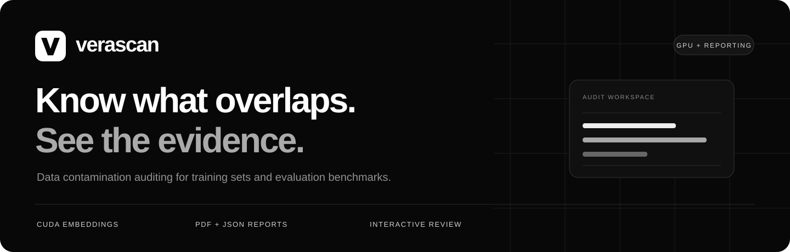
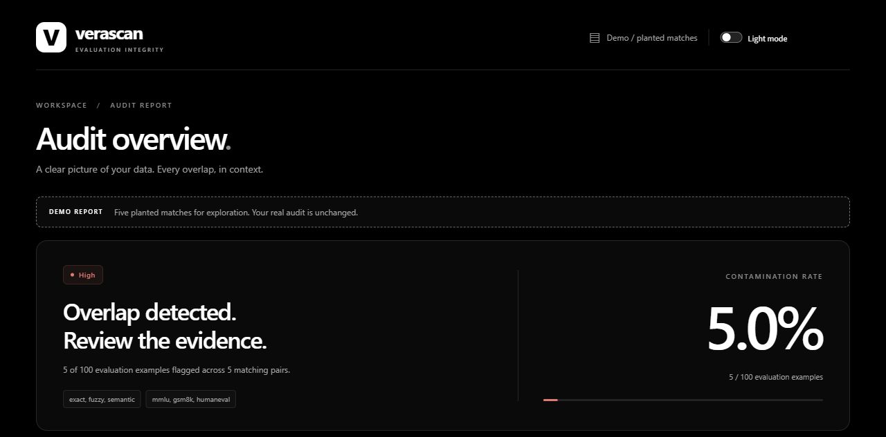
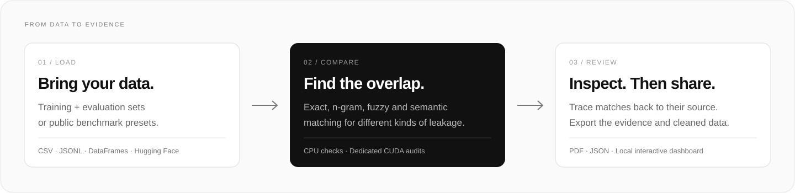
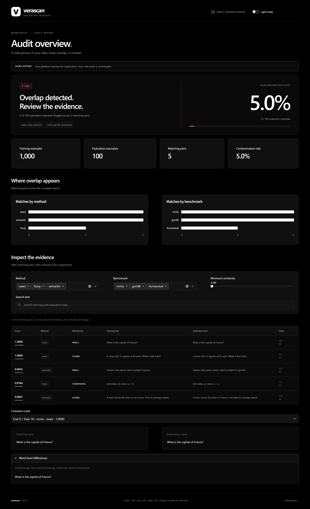
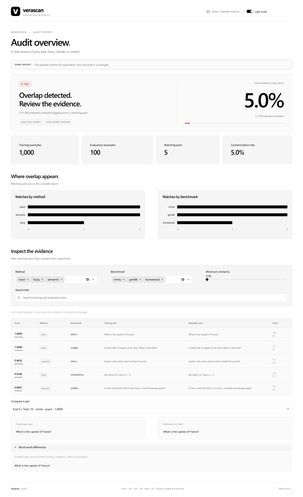
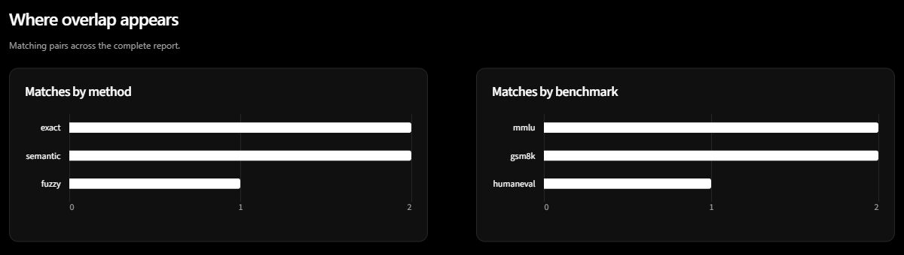
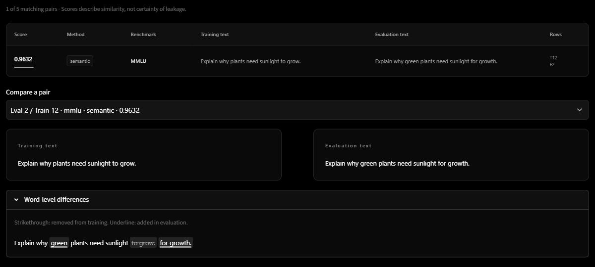

<p align="center">
  
</p>

<p align="center">
  <a href="https://pypi.org/project/verascan/"></a>
  <a href="https://github.com/balamuruganpg/verascan/actions/workflows/ci.yml?query=branch%3Amain+event%3Apush"></a>
  <a href="https://pypi.org/project/verascan/"></a>
  <a href="https://github.com/balamuruganpg/verascan/blob/main/LICENSE"></a>
</p>

<p align="center">
  <a href="#quick-start">Quick start</a> ·
  <a href="#nvidia-gpu-audits">GPU audits</a> ·
  <a href="#the-report-workspace">Dashboard</a> ·
  <a href="#python-api">Python API</a> ·
  <a href="https://github.com/balamuruganpg/verascan/blob/main/CHANGELOG.md">Changelog</a>
</p>

# Verascan

**Find training–evaluation overlap. Investigate every match. Share the evidence.**

Verascan detects exact duplicates, shared passages, near-duplicates and semantic
overlap between training data and evaluation examples. Use it to check dataset
splits, audit public benchmarks, inspect matching text, and export reviewable
reports before trusting an evaluation result.

**0.6.0 brings dedicated NVIDIA CUDA auditing, PDF reports, and a local dashboard
with black and white themes.** JSON remains the machine-readable record behind
the reporting workflow.



*Dashboard demo with five planted matches. The percentage illustrates the demo
dataset; it is not a measurement of a public training corpus.*

## From datasets to evidence



| Task | What you get |
| --- | --- |
| **Check existing splits** | Exact, n-gram, fuzzy and semantic detection with source row indices and scores. |
| **Audit benchmarks** | Compare training data against MMLU, GSM8K and HumanEval presets. |
| **Use NVIDIA CUDA** | Batched CUDA embeddings, GPU-preferred FAISS indexing, device diagnostics and row limits. |
| **Review the evidence** | Searchable pairs, method/benchmark/score filters, side-by-side text and word differences. |
| **Share results** | Multi-page PDF reports and JSON exports; legacy self-contained HTML is also supported. |
| **Prepare cleaner data** | Export flagged or cleaned evaluation rows, or create splits while filtering detected overlap. |

## Quick start

Install the dashboard workflow on **Python 3.11+**:

```bash
pip install "verascan[dashboard]"
```

Run a small check and save both report formats:

```python
import verascan

report = verascan.check(
    train=["The capital of France is Paris.", "A separate training example."],
    eval=["The capital of France is Paris.", "An unseen evaluation example."],
    methods=["exact", "fuzzy"],
)

print(report.summary())
report.to_pdf("report.pdf")
report.to_json("report.json")
```

Open the report workspace:

```bash
verascan dashboard report.json
```

Or explore all the review tools with five planted pairs, without running an audit:

```bash
verascan dashboard report.json --demo
```

Demo mode uses separate sample data and leaves your report unchanged. The server
runs locally on `127.0.0.1`; stop it with **Ctrl+C**.

## The report workspace

Start with the contamination rate, then follow the result down to individual text
pairs. The rate counts **unique flagged evaluation examples**, not matching pairs.
Exact flagged/total counts appear alongside the percentage.

### Black or white. The same evidence.

Use **Light mode** in the header to change themes. Your filters and selected pair
stay in place. Status uses green, amber or red; charts, controls and text review
stay monochrome.

<table width="100%">
  <thead><tr><th>Dark theme</th><th>Light theme</th></tr></thead>
  <tbody><tr>
    <td width="50%"><a href="screenshots/screencapture-127-0-0-1-8501-2026-11-04-18_23_11.png"></a></td>
    <td width="50%"><a href="screenshots/screencapture-127-0-0-1-8501-2026-11-04-18_19_33.png"></a></td>
  </tr></tbody>
</table>

*Full-page demo captures. Open either image to inspect it at full resolution.*

### Understand where matches come from

Method and benchmark charts appear when a report contains matches. Clean reports
show a completion panel and audit scope instead of empty charts.



The status labels are display categories: **Clean = 0%**, **Low < 5%**, and
**High ≥ 5%**. They are not statistical confidence estimates. Percentages display
up to six decimal places, using scientific notation for smaller nonzero rates.

### Inspect a pair, not just a number

Filter by method, benchmark and minimum similarity; search the training and
evaluation text literally. Review 25 pairs per page, select a pair, and compare
its original text side by side. Strikethrough identifies words removed from
training text; underline identifies words added in evaluation text.



*Demo evidence. Similarity is a reason to investigate a pair, not proof that a
model was trained on an evaluation example.*

## Installation options

The core package supports **Python 3.9+**. The optional dashboard requires
**Python 3.11+**. PDF export is included in the core installation.

| Install | Includes |
| --- | --- |
| `pip install verascan` | Core matching, dataset splitting, PDF, JSON and HTML export. |
| `pip install "verascan[semantic]"` | Sentence-transformer embeddings and FAISS-CPU. |
| `pip install "verascan[hf]"` | Hugging Face datasets by name or Dataset object. |
| `pip install "verascan[all]"` | CPU semantic and Hugging Face extras. |
| `pip install "verascan[gpu]"` | CUDA audit dependencies and Hugging Face support. |
| `pip install "verascan[dashboard]"` | The local Streamlit report workspace. |
| `pip install "verascan[gpu,dashboard]"` | GPU auditing and the dashboard workflow. |

The `all` extra covers CPU semantic and Hugging Face support; GPU and dashboard
extras are selected separately.

## NVIDIA GPU audits

GPU auditing requires an NVIDIA driver and a **CUDA-enabled PyTorch build**.
Choose the build for your OS and driver using the
[official PyTorch installer](https://pytorch.org/get-started/locally/).
Installing the GPU extra alone does not replace an existing CPU-only PyTorch build.

```bash
pip install "verascan[gpu,dashboard]"
```

For example, on the tested Windows/Python 3.11 setup with a compatible NVIDIA
driver, PyTorch 2.8 with CUDA 12.6 can be selected explicitly:

```powershell
python -m pip install "torch==2.8.0+cu126" --index-url https://download.pytorch.org/whl/cu126
python -c "import torch; print(torch.__version__, torch.version.cuda, torch.cuda.is_available())"
```

Use the [official version instructions](https://pytorch.org/get-started/previous-versions/)
when choosing a different PyTorch or CUDA version.

### Run a controlled benchmark audit

```bash
verascan gpu --train imdb --benchmarks mmlu,gsm8k --column text --device cuda --batch-size 64 --max-train 2000 --max-eval 200 --output report.pdf --output-json report.json
verascan dashboard report.json
```

Or use the Python API:

```python
import verascan

report = verascan.gpu_audit(
    train="imdb",
    benchmarks=["mmlu", "gsm8k", "humaneval"],
    column="text",
    device="cuda",
    batch_size=64,
    max_train=2000,
    max_eval=200,
)
report.to_pdf("report.pdf")
report.to_json("report.json")
```

- The command prints the device, CUDA runtime and free/total memory before loading data.
- Embedding, indexing and search run in batches with progress bars. The GPU default
  is **256**; lower `--batch-size` when device memory is limited.
- `--max-train` bounds training rows; `--max-eval` bounds rows **per benchmark**.
  Without limits, the GPU path uses the full training split.
- GPU audits use semantic matching and retain up to **10 nearest training
  neighbors per evaluation row**, filtered by `--threshold` (default `0.85`).
- `--device cuda:N`, `--train-split`, `--benchmark-split`, `--config` and
  `--model-name` control the device, dataset partitions and embedding model.
- `--no-progress` disables progress bars. Dataset text, the index and retained
  matches must still fit memory; batching does not make total memory unbounded.

### FAISS platform behavior

| Environment | Embeddings | Index |
| --- | --- | --- |
| Compatible FAISS-GPU installation | NVIDIA CUDA | GPU preferred; CPU fallback after index failure. |
| Windows or another platform using FAISS-CPU | NVIDIA CUDA | CPU index with one clear availability notice. |
| CUDA unavailable or CPU-only PyTorch | Audit stops with an installation diagnostic. | No silent CPU embedding fallback. |

The GPU extra selects `faiss-gpu` on Linux x86-64 and `faiss-cpu` on other
platforms. If a compatible Linux wheel is unavailable, follow the
[FAISS installation instructions](https://github.com/facebookresearch/faiss/blob/main/INSTALL.md)
for a suitable GPU build, then install the remaining dependencies in that
environment. Do not install FAISS-CPU and FAISS-GPU together: both provide `faiss`.

For CUDA embeddings with a CPU index, `verascan[semantic,hf]` plus CUDA-enabled
PyTorch is also supported. A missing or failed GPU index never moves embeddings
off CUDA. Existing CPU `check`, `audit` and `split` paths remain available.

## PDF, JSON and cleaned data

PDF reports include a cover with the rate, dataset sizes, methods and benchmarks;
a paginated match index; and highlighted word-level differences. JSON preserves
the results for automation and the dashboard.

```python
report.to_pdf("report.pdf")
report.to_json("report.json")

cleaned = report.cleaned_eval()
flagged = report.contaminated_eval()
report.to_cleaned("eval-cleaned.jsonl")
report.to_contaminated("eval-flagged.jsonl")
```

The legacy self-contained HTML export remains available through
`report.to_html("report.html")`. PDF and the JSON dashboard are the primary
reporting workflows.

Bundled DejaVu fonts cover Latin, Greek and Cyrillic. Review scripts requiring
additional fonts or shaping in the dashboard or original JSON.

## CPU checks and benchmark presets

```bash
# Compare existing training and evaluation files.
verascan check --train train.jsonl --eval eval.jsonl --methods exact,fuzzy --output report.pdf --output-json report.json

# Audit against public benchmark presets.
verascan audit --train imdb --benchmarks mmlu,gsm8k --output report.pdf --output-json report.json

# Fail a CI job when contamination exceeds 1%.
verascan check --train train.jsonl --eval eval.jsonl --fail-above 0.01
```

| Method | Detects | Optional dependency |
| --- | --- | --- |
| `exact` | Normalized verbatim duplicates. | Core installation. |
| `ngram` | Shared word passages; 13-word grams by default. | Core installation. |
| `fuzzy` | Near-duplicates using MinHash and locality-sensitive hashing. | Core installation. |
| `semantic` | Similar meaning using normalized sentence embeddings and FAISS search. | `semantic` extra. |

For offline benchmark examples, `verascan audit --synthetic` uses small synthetic
stand-ins. It does not measure contamination against the actual public benchmarks.

## Python API

### Flexible inputs

Inputs can be string lists, row dictionaries, pandas DataFrames, CSV or JSONL
paths, Hugging Face Dataset objects, or dataset names with the `hf` extra.

```python
import verascan

report = verascan.check(
    train="imdb",
    eval="imdb",
    train_split="train[:1000]",
    eval_split="test[:200]",
    column="text",
    methods=["exact", "fuzzy"],
)

audit_report = verascan.audit(
    train="imdb",
    benchmarks=["mmlu", "gsm8k"],
    methods=["exact", "fuzzy"],
    split="train[:2000]",
)
```

### Build splits while filtering overlap

```python
import verascan

train, eval_set = verascan.split(
    data="data.jsonl",
    eval_size=0.2,
    methods=["exact", "fuzzy"],
    threshold=0.85,
    seed=42,
    move_to="train",  # Move detected overlap to train, or use "drop".
    output_train="train.jsonl",
    output_eval="eval.jsonl",
)
```

```bash
verascan split --input data.jsonl --eval-size 0.2 --output-train train.jsonl --output-eval eval.jsonl
```

### Inspect results programmatically

```python
report.contamination_rate  # Fraction of evaluation examples flagged.
report.formatted_contamination_rate  # Display percentage, including small nonzero rates.
report.matches  # MatchRecord objects with text, indices, score and method.
report.flagged(min_score=0.9)  # Matching pairs meeting a score cutoff.
print(report.summary())  # summary() returns text without printing itself.
payload = report.to_dict()

audit_report.benchmark_counts  # Unique flagged examples by benchmark.
audit_report.by_benchmark()  # Matching pairs grouped by benchmark.
```

Each `MatchRecord` has `eval_index`, `train_index`, `eval_text`, `train_text`,
`score` and `method`. JSON audit exports also associate matches with benchmarks.

## Interpreting the result

- **Similarity is evidence to review.** Scores are method-specific: exact matches
  score `1.0`; fuzzy matching uses Jaccard similarity; semantic matching uses
  cosine similarity. They are not probabilities of training-data exposure.
- **A clean report has a scope.** It applies to the supplied examples, methods,
  model and threshold. It does not prove that a larger corpus has no leakage.
- **Short text changes detection behavior.** Word n-gram matching needs at least
  `ngram_n` words; the fuzzy engine falls back to exact matching on very short text.
- **The default embedding model targets English.** Choose a suitable multilingual
  `model_name` when comparing other languages.
- **Control large runs.** HF split slices can bound loading; local files and dataset
  objects may be materialized before limits are applied. GPU fallback can re-encode
  training batches when rebuilding a CPU index.

## Development

```bash
git clone https://github.com/balamuruganpg/verascan.git
cd verascan
pip install -e ".[all,dev]"
pytest tests/ -v --tb=short
ruff check .
ruff format --check .
mypy src/
python -m build
```

Package builds use this README for the PyPI long description, converting local
`screenshots/` image links to absolute GitHub URLs. Push the referenced image
files to GitHub before publishing a release so PyPI can retrieve them.

## License

Verascan is released under the [MIT license](https://github.com/balamuruganpg/verascan/blob/main/LICENSE).
