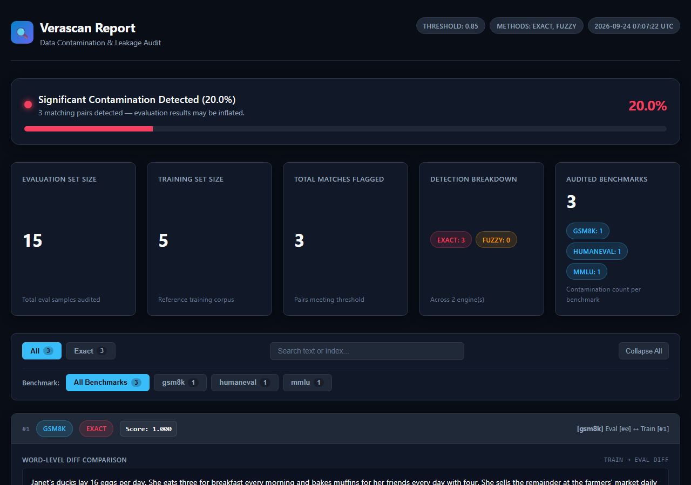
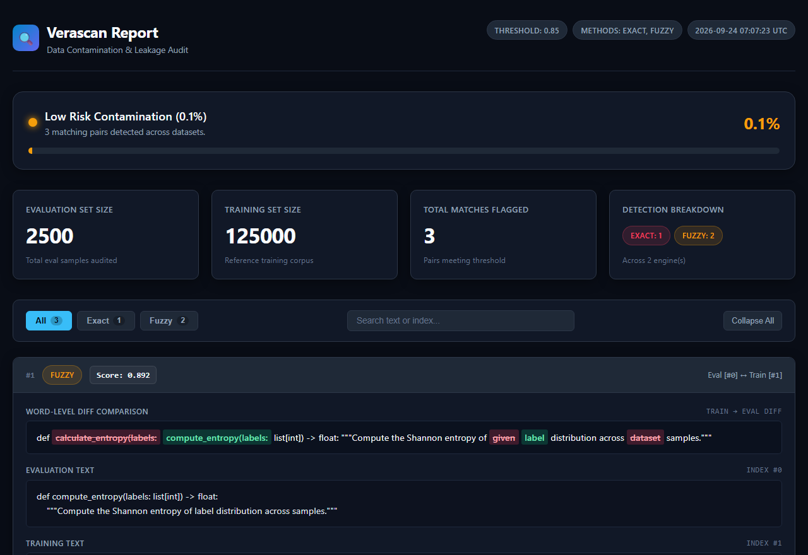

<div align="center">

# Verascan

**Data Contamination & Leakage Detection for AI / ML Workflows**

[](https://pypi.org/project/verascan/)
[](https://github.com/balamuruganpg/verascan/actions/workflows/ci.yml)
[](https://pypi.org/project/verascan/)
[](https://github.com/balamuruganpg/verascan/blob/main/LICENSE)
[](https://github.com/balamuruganpg/verascan/actions)
[](https://mypy-lang.org/)
[](https://github.com/astral-sh/ruff)

<br>

<p align="center">
  <strong>Detect exact, n-gram, fuzzy, and semantic data leakage between training and evaluation datasets.</strong><br>
  Built for LLM fine-tuning, benchmark integrity, RAG validation, and synthetic data auditing.
</p>

<br>

<p align="center">NVIDIA CUDA benchmark auditing. PDF reports for sharing. A local dashboard for investigation.</p>

</div>

---

## 🎯 Overview

Data contamination occurs when evaluation or benchmark examples leak into a model's training data. This compromises evaluation validity, inflates benchmark scores, and masks real-world model degradation.

**Verascan** provides an end-to-end contamination detection and prevention pipeline:
1. **Prevention (`verascan.split`)** — Partition raw datasets into train and eval splits with a mathematical guarantee of zero exact, fuzzy, or semantic leakage.
2. **Benchmark Audit (`verascan.audit`)** — Audit training data against popular public benchmarks (`mmlu`, `gsm8k`, `humaneval`).
3. **Contamination Audit (`verascan.check`)** — Multi-tier contamination scanner across existing splits:
   - **Exact match** — $O(N)$ hash-based verbatim duplicate detection with normalisation.
   - **N-gram overlap** — GPT-3-style word 13-gram collisions (Brown et al., 2020) with frequency filtering.
   - **Fuzzy match** — MinHash + Locality-Sensitive Hashing (LSH) for near-duplicates and minor edits.
   - **Semantic match** — Dense embedding similarity search (`sentence-transformers` + FAISS) for paraphrased content.
4. **Remediation (`report.cleaned_eval` / `to_cleaned`)** — Automatically drop contaminated rows and export a pristine benchmark.

---

## ✨ Features

- **Leak-Free Dataset Splitting**: Proactively partition raw datasets into train and eval splits with 0.0% residual leakage (`verascan.split()` and CLI `verascan split`).
- **Multi-Tier Detection**: Run exact, ngram, fuzzy, and semantic algorithms independently or in a cascaded pipeline.
- **Cross-Method Deduplication**: Matches identified by earlier methods are automatically excluded from later passes to prevent double-counting.
- **Multi-Format Ingestion**: Natively accepts `pandas.DataFrame`, `JSONL`, `CSV`, Hugging Face `datasets.Dataset`, `list[str]`, and `list[dict]`.
- **NVIDIA GPU Audits**: Dedicated CUDA embedding path with GPU-preferred FAISS, batched indexing/search, device diagnostics, and controlled row limits.
- **PDF Reports and Dashboard**: Share paginated PDF summaries, match tables, and highlighted word differences; investigate JSON reports with a local Streamlit dashboard, charts, search, and filters. Legacy self-contained HTML remains available.
- **Cleaned Eval Export**: Drop contaminated eval rows and write a reusable CSV/JSONL benchmark (`cleaned_eval()`, `to_cleaned()`, CLI `--output-cleaned`).
- **CI/CD Integration**: CLI includes `--fail-above` to fail builds if contamination exceeds an allowed threshold.
- **Lightweight Core**: Installs cleanly with minimal dependencies; heavy ML dependencies (`sentence-transformers`, `faiss-cpu`) are optional extras.
- **Noise-Free Execution**: Built-in log suppression prevents noisy C++/oneDNN and framework deprecation logs from polluting `stderr`.

---

## 🔬 Detection Engines

| Method | Algorithm | Complexity / Speed | Best For |
|---|---|---|---|
| **`exact`** | SHA-256 Content Hashing (normalised) | $O(N + M)$ &bull; *Microseconds* | Verbatim duplicates, casing/whitespace variations |
| **`ngram`** | Word *n*-gram overlap (GPT-3 / Brown et al.) | $O(N + M)$ &bull; *Milliseconds* | Long shared phrases; classic 13-gram contamination |
| **`fuzzy`** | MinHash + LSH (`datasketch`) | $O(N + M)$ &bull; *Milliseconds* | Minor edits, word insertions/deletions, truncations |
| **`semantic`** | Dense Vector Cosine Similarity (FAISS) | $O(M \cdot d)$ &bull; *Seconds* | Paraphrased sentences, reworded questions, synonyms |

---

## 📦 Installation

Verascan is available on PyPI at **https://pypi.org/project/verascan/**:

```bash
# Core installation (exact + fuzzy matching + split utility)
pip install verascan

# With semantic similarity matching (sentence-transformers + FAISS)
pip install "verascan[semantic]"

# With Hugging Face datasets support
pip install "verascan[hf]"

# CPU semantic + Hugging Face extras (GPU and dashboard are separate)
pip install "verascan[all]"

# NVIDIA GPU auditing (also includes Hugging Face dataset support)
pip install "verascan[gpu]"

# Local interactive report dashboard (Python 3.11+)
pip install "verascan[dashboard]"
```

PDF export is included in the core installation. GPU auditing needs an NVIDIA
driver and a **CUDA-enabled PyTorch build**. Follow the
[PyTorch installation selector](https://pytorch.org/get-started/locally/) for your
OS and CUDA runtime; a CPU-only PyTorch install cannot run `gpu_audit`.

The GPU extra requests `sentence-transformers`, `torch`, `datasets`, and a
platform-selected FAISS package. **Linux x86-64 uses `faiss-gpu`; Windows and
other platforms use `faiss-cpu`** because NVIDIA FAISS-GPU wheels are not
universally available. On Windows, embeddings run on CUDA while the index uses
the documented FAISS-CPU fallback, with a visible warning.

An installed CPU-only PyTorch build already satisfies `torch>=2.0`; installing
the GPU extra does **not** automatically replace it with a CUDA build. For
example, this Windows/Python 3.11 setup explicitly selects PyTorch 2.8 with CUDA
12.6 (an NVIDIA driver compatible with CUDA 12.6 is required):

```powershell
python -m pip install -e ".[gpu,dashboard]"
python -m pip install "torch==2.8.0+cu126" --index-url https://download.pytorch.org/whl/cu126
python -c "import torch; print(torch.__version__, torch.version.cuda, torch.cuda.is_available())"
```

Use the [official PyTorch version instructions](https://pytorch.org/get-started/previous-versions/)
when selecting a different version or CUDA runtime. `nvidia-smi` detects the
driver/GPU; `torch.cuda.is_available()` verifies that Python can actually use it.

For full FAISS-GPU indexing, use a compatible Linux setup following
[FAISS installation instructions](https://github.com/facebookresearch/faiss/blob/main/INSTALL.md)
(for example, WSL2/Linux with a compatible Conda build). If pip cannot resolve
the Linux wheel, install FAISS-GPU separately, then install Verascan and
the remaining dependencies in that same environment:

```bash
pip install "verascan[hf]" sentence-transformers
# Install CUDA-enabled torch using the PyTorch selector above.
# Install FAISS-GPU using the FAISS instructions above.
```

For CUDA embeddings with a CPU FAISS index, install
`pip install "verascan[semantic,hf]"` and CUDA-enabled PyTorch instead.
Verascan first attempts a GPU index; an unavailable or failing GPU index emits
a warning and retries on FAISS-CPU. **Embeddings remain on CUDA**. Missing CUDA
is an error, never a silent switch to CPU embeddings. Avoid installing
`faiss-cpu` and `faiss-gpu` together: both provide the `faiss` module.

## NVIDIA GPU benchmark audits (0.6.0)

```python
import verascan

report = verascan.gpu_audit(
    train="imdb",
    benchmarks=["mmlu", "gsm8k", "humaneval"],
    column="text",
    device="cuda",
    batch_size=64,
    max_train=10000,
    max_eval=1000,
)
print(report.summary())
report.to_pdf("report.pdf")
report.to_json("report.json")
```

```bash
verascan gpu --train imdb --benchmarks mmlu,gsm8k --column text --device cuda --batch-size 64 --output report.pdf --output-json report.json

# Larger runs, with explicit row limits and a selected GPU
verascan gpu --train imdb --benchmarks mmlu,gsm8k,humaneval --device cuda:0 --batch-size 256 --max-train 10000 --max-eval 1000 --output report.pdf --output-json report.json

verascan dashboard report.json
```

The GPU command prints the selected device, CUDA runtime, and free/total memory
before loading datasets. GPU batches default to **256**; reduce `--batch-size`
if CUDA memory is exhausted. Progress bars cover training embedding/indexing
and evaluation embedding/search; `--no-progress` disables them.

GPU audits run semantic matching and retain up to **10 nearest training
neighbors per evaluation row**, filtered by `--threshold` (default 0.85).
`--max-train` limits training rows, and `--max-eval` limits rows **per benchmark**.
Without limits, the GPU path uses the full training split. HF limits are passed
as split slices when possible; local files and dataset objects are loaded before
slicing. Batching bounds temporary embedding memory; the dataset texts, index,
and result pairs must still fit memory. A FAISS fallback may re-encode training
batches to rebuild the CPU index. Use `--train-split`, `--benchmark-split`, and
`--config` for dataset controls, or `--model-name` for another embedding model.
The existing CPU `check`, `audit`, and `split` detection paths are unchanged.

## PDF reports and interactive dashboard

```python
report = verascan.check(train="train.jsonl", eval="eval.jsonl")
report.to_pdf("report.pdf")  # Summary cover, match table, highlighted word diffs
report.to_json("report.json")  # Machine-readable results and dashboard input
```

```bash
verascan check --train train.jsonl --eval eval.jsonl --output report.pdf
verascan audit --train train.jsonl --benchmarks gsm8k,mmlu --output report.pdf --output-json report.json
verascan dashboard report.json
```

Preview the dashboard with five planted pairs across three benchmarks:

```bash
verascan dashboard report.json --demo
```

Demo mode displays separate sample data and never changes the real report.

PDF is the sharing format; JSON powers the investigation dashboard. The PDF
includes contamination rate, train/eval sizes, methods, benchmarks, scores, and
paginated word-level differences. Bundled DejaVu fonts cover Latin, Greek, and
Cyrillic; scripts requiring other fonts/shaping should be reviewed in the
dashboard or original JSON. Fonts and their license ship with the package.

The audit must complete successfully before its JSON file can be opened; an
audit that exits with a CUDA error does not create a dashboard report.

The dashboard runs locally on `127.0.0.1`, accepts existing 0.5.0 JSON exports,
and opens a monochrome report workspace with a status card and four summary metrics.
Use **Light mode** in the header to switch between a pure black dark theme and
a pure white light theme. Filters and the selected pair stay in place while
switching. Charts, controls, tables and word differences use grayscale; green,
amber and red are reserved for contamination status.
Clean reports show a completion panel and audit scope; reports with matches
show method and benchmark charts. Filter by method, benchmark, or minimum
score, search text literally, and review 25 pairs per page with side-by-side
source text and highlighted differences. Status labels use Clean = 0%,
Low < 5%, and High >= 5%; these are display categories, not statistical confidence.
The rate counts unique evaluation examples and displays up to six decimal
places (scientific notation for smaller nonzero rates), with exact flagged/total
counts alongside it. Summary charts describe the full report; filters narrow
the review table. Stop with
Ctrl+C. HTML export remains a secondary option through `report.to_html()`.

---

## 🛡️ Leak-Free Splitting (`verascan.split`)

Instead of auditing datasets *after* training, prevent leakage upfront with `verascan.split()`. It partitions your dataset and iteratively purges candidate evaluation examples that are too similar to training samples:

### Python API

```python
import verascan

# Create a leak-free train and eval split
train, eval_set = verascan.split(
    data="data/raw_dataset.jsonl",
    eval_size=0.2,
    methods=["exact", "fuzzy"],
    seed=42,
    output_train="data/train.jsonl",
    output_eval="data/eval.jsonl",
)

print(f"Train samples: {len(train):,}")
print(f"Eval samples : {len(eval_set):,}")
```

### CLI Command

```bash
verascan split \
  --input data/raw_dataset.jsonl \
  --eval-size 0.2 \
  --output-train data/train.jsonl \
  --output-eval data/eval.jsonl \
  --methods exact,fuzzy \
  --threshold 0.85
```

---

## 🏛️ Benchmark Auditing (`verascan.audit`)

Audit your training data directly against popular public evaluation benchmarks (`mmlu`, `gsm8k`, `humaneval`) to detect pre-training contamination before benchmark evaluation:

```python
import verascan

report = verascan.audit(
    train="data/train.jsonl",
    benchmarks=["mmlu", "gsm8k", "humaneval"],
    methods=["exact", "fuzzy"],
    threshold=0.85,
)

report.summary()
report.to_pdf("audit_report.pdf")
```

<p align="center">
  
</p>

---

## 🚀 Contamination Audit (`verascan.check`)

### Python API

```python
import verascan

# Run contamination audit across training and evaluation splits
report = verascan.check(
    train="data/train.jsonl",
    eval="data/eval.jsonl",
    methods=["exact", "ngram", "fuzzy", "semantic"],
    threshold=0.85,
)

# Print terminal summary
report.summary()

# Inspect metrics
print(f"Contamination Rate: {report.contamination_rate:.1%}")
print(f"Flagged Pairs     : {report.total_matches}")

# Query high-confidence matches
for match in report.flagged(min_score=0.90):
    print(
        f"[{match.method}] Eval #{match.eval_index} <-> Train #{match.train_index} (Score: {match.score:.3f})"
    )
    print(f"  Eval : {match.eval_text}")
    print(f"  Train: {match.train_text}")

# Export a PDF report and JSON for the interactive dashboard
report.to_pdf("contamination_report.pdf")
report.to_json("contamination_report.json")

# Export a decontaminated eval set (contaminated rows removed)
cleaned = report.cleaned_eval()  # list[str] or pandas.DataFrame
report.to_cleaned("eval_cleaned.jsonl")  # .jsonl, .csv, or .json
```

### Terminal Output

```text
===============================================
  Verascan Contamination Report
===============================================
  Train size      : 50,000
  Eval size       : 1,000
  Methods         : exact, fuzzy, semantic
  Threshold       : 0.85
-----------------------------------------------
  Total matches   : 14
  Contaminated    : 12 / 1,000 eval samples (1.2%)
    Exact matches : 4
    Fuzzy matches : 7
    Semantic hits : 3
===============================================
```

---

## 📂 Supported Input Formats

Verascan normalises inputs into clean text sequences automatically:

```python
import pandas as pd
import verascan

# 1. Plain String Lists
report = verascan.check(
    train=["The quick brown fox.", "Artificial intelligence."],
    eval=["The quick brown fox."],
)

# 2. File Paths (CSV or JSONL)
report = verascan.check(
    train="data/train.jsonl",
    eval="data/eval.csv",
    column="text",
)

# 3. Pandas DataFrames
train_df = pd.DataFrame({"prompt": ["Translate to French...", "Summarize..."]})
eval_df = pd.DataFrame({"prompt": ["Translate to French..."]})
report = verascan.check(train=train_df, eval=eval_df, column="prompt")

# 4. Hugging Face Datasets (by name or Dataset object)
# Direct dataset name string with custom splits & configs
report = verascan.check(
    train="gsm8k",
    eval="gsm8k",
    column="question",
    train_split="train[:500]",
    eval_split="test[:200]",
    config="main",
)

# Or audit directly against public benchmark presets
audit_report = verascan.audit(
    train="imdb",
    benchmarks=["mmlu", "gsm8k"],
    column="text",
    split="train[:2000]",
)
```

---

## 💻 CLI Usage

The `verascan` CLI enables automated auditing and dataset splitting in terminal workflows and CI/CD pipelines:

### 1. Split Datasets

```bash
# Partition dataset into leak-free splits
verascan split \
  --input data/raw_dataset.jsonl \
  --eval-size 0.2 \
  --output-train data/train.jsonl \
  --output-eval data/eval.jsonl
```

### 2. Audit Contamination

```bash
# Basic contamination check
verascan check --train data/train.jsonl --eval data/eval.jsonl

# Custom columns, methods, threshold, HTML report, and cleaned output
verascan check \
  --train data/train.csv \
  --eval data/eval.csv \
  --methods exact,fuzzy \
  --threshold 0.80 \
  --column text \
  --output report.html \
  --output-cleaned eval_cleaned.jsonl

# CI/CD Gate: Fail build if contamination rate exceeds 1%
verascan check \
  --train data/train.jsonl \
  --eval data/eval.jsonl \
  --fail-above 0.01
```

### 3. Benchmark Auditing

```bash
# Fast offline audit with synthetic stand-ins
verascan audit --train train.jsonl --benchmarks mmlu,gsm8k --synthetic

# Full benchmark audit with interactive HTML report
verascan audit \
  --train data/train.jsonl \
  --benchmarks mmlu,gsm8k,humaneval \
  --output audit_report.html
```

---

## 📊 Secondary HTML export

For an offline single-file alternative, the legacy HTML report generated via `report.to_html("report.html")` is **100% self-contained** (no external fonts, CDNs, or scripts required):

- **Health Status Banner**: Visual indicator (`Clean`, `Low Risk`, `High Risk`) with contamination percentage and progress meter.
- **Method Breakdown**: Color-coded badges for exact (Rose), fuzzy (Amber), and semantic (Indigo) detections.
- **Live Search & Filtering**: Instant client-side search across text samples and index numbers.
- **Word-Level Diffs**: Color-coded `<del>` and `<ins>` tags illustrating textual overlap.
- **Responsive Layout**: Designed for seamless viewing across desktop monitors and mobile devices.

<p align="center">
  
</p>

---

## ⚙️ Python API Reference

### `verascan.split(data, ...)`

```python
train, eval = verascan.split(
    data,  # str | pd.DataFrame | list[str] | list[dict] | Dataset
    eval_size=0.2,  # float ratio (0-1) or int row count
    methods=["exact", "fuzzy"],  # exact, fuzzy, semantic
    threshold=0.85,  # similarity threshold (0-1)
    column="text",  # text column for tabular inputs
    seed=42,  # random seed for reproducible partition
    move_to="train",  # "train" (preserve data) or "drop" (discard)
    output_train="train.jsonl",  # optional path (.csv, .jsonl, .json)
    output_eval="eval.jsonl",  # optional path (.csv, .jsonl, .json)
)
```

### `verascan.audit(train, ...)`

```python
report = verascan.audit(
    train="train.jsonl",  # path, DataFrame, list[str], list[dict], or Dataset
    benchmarks=["mmlu", "gsm8k", "humaneval"],  # preset names
    methods=["exact", "fuzzy"],  # exact, ngram, fuzzy, semantic
    threshold=0.85,  # similarity cutoff
    synthetic=False,  # set True for local offline testing
)

report.benchmark_counts  # dict: e.g. {"mmlu": 1, "gsm8k": 0, "humaneval": 2}
report.by_benchmark()  # dict: matches grouped by benchmark name
```

### `verascan.check(train, eval, ...)`

```python
report = verascan.check(train, eval)

# Properties
report.contamination_rate  # float: Fraction of eval examples found in train (0.0 to 1.0)
report.formatted_contamination_rate  # str: Formatted rate (e.g. "0.006%", never "0.0%" if matches exist)
report.total_matches  # int: Total flagged pairs
report.exact_count  # int: Exact duplicate count
report.ngram_count  # int: N-gram overlap match count
report.fuzzy_count  # int: Fuzzy / near-duplicate count
report.semantic_count  # int: Semantic match count
report.train_size  # int: Size of training corpus
report.eval_size  # int: Size of evaluation corpus

# Methods
report.flagged(min_score=0.9)  # Returns list of MatchRecord objects >= min_score
report.summary()  # Prints ASCII summary to stdout
report.to_dict()  # Serialises report to a Python dict
report.to_json("report.json")  # Exports JSON file
report.to_pdf("report.pdf")  # Exports paginated PDF with highlighted differences
report.to_html("report.html")  # Exports self-contained interactive HTML report
report.cleaned_eval()  # Eval examples with contaminated rows removed
report.contaminated_eval()  # Eval examples that were flagged
report.to_cleaned("eval_clean.jsonl")  # Write cleaned eval as CSV / JSONL / JSON
report.to_contaminated("eval_flagged.jsonl")  # Write flagged eval rows
```

### `MatchRecord` Structure

Each match in `report.matches` contains:
- `eval_index: int` — Index of the sample in the evaluation dataset.
- `train_index: int` — Index of the sample in the training dataset.
- `eval_text: str` — Evaluation sample text.
- `train_text: str` — Matching training sample text.
- `score: float` — Similarity metric (`1.0` for exact matches, n-gram overlap ratio for ngram, Jaccard for fuzzy, cosine for semantic).
- `method: str` — Engine that produced the match (`"exact"`, `"ngram"`, `"fuzzy"`, `"semantic"`).

---

## ⚠️ Limitations

- **Large-Scale Semantic Search**: While FAISS provides fast approximate search, semantic matching encodes all samples using transformer models, which is compute-intensive on CPU for corpora with millions of rows. For very large datasets, start with `methods=["exact", "fuzzy"]`.
- **Character N-Gram Sensitivity**: Fuzzy matching relies on character 5-grams by default. Very short texts (fewer than 5 characters) fall back to exact matching.
- **Word N-Gram Length**: The `ngram` method needs at least `ngram_n` words (default 13) after cleaning; shorter eval texts produce no n-gram matches.
- **Cross-Lingual Matching**: The default semantic model (`all-MiniLM-L6-v2`) is optimized for English text. For multilingual evaluation datasets, specify a multilingual model via `model_name="paraphrase-multilingual-MiniLM-L12-v2"`.

---

## 🛠️ Development

```bash
# Clone repository
git clone https://github.com/balamuruganpg/verascan.git
cd verascan

# Install development dependencies
pip install -e ".[all,dev]"

# Run test suite
pytest

# Code formatting and linting
ruff check .
ruff format --check .

# Type checking
mypy src/
```

---

## 📄 License

Distributed under the [MIT License](https://github.com/balamuruganpg/verascan/blob/main/LICENSE).
